<div align="center">

# 📍 TrackRp

**Système de gestion et de suivi en temps réel des véhicules de la Rapide Poste Tunisienne**


*Projet de fin d'études – Licence en Ingénierie des Systèmes Informatiques*
*ISSAT Mateur – Université de Carthage – 2024/2025*

</div>

---

## 📑 Table des matières

- [À propos](#-à-propos)
- [Contexte et problématique](#-contexte-et-problématique)
- [Fonctionnalités](#-fonctionnalités)
- [Rôles et permissions](#-rôles-et-permissions)
- [Architecture](#-architecture)
- [Stack technique](#-stack-technique)
- [Prérequis](#-prérequis)
- [Installation et lancement](#-installation-et-lancement)
- [Structure du projet](#-structure-du-projet)
- [Matériel embarqué (IoT)](#-matériel-embarqué-iot)
- [Captures d'écran](#-captures-décran)
- [Perspectives](#-perspectives)
- [Auteure et encadrement](#-auteure-et-encadrement)

---

## 🎯 À propos

**TrackRp** est une application web de supervision de flotte qui permet de localiser les véhicules de la Rapide Poste en temps réel, de consulter l'historique des trajets et de recevoir des alertes en cas d'anomalie (excès de vitesse, sortie de zone autorisée, arrêt prolongé, perte de signal…).

Ce dépôt contient le **frontend Angular**. Il s'appuie sur un serveur **[Traccar](https://www.traccar.org/)** (backend Java) qui reçoit les trames GPS envoyées par des modules embarqués **ESP32 + SIM808**.

> ⚠️ **Le backend Traccar est obligatoire.** Ce frontend ne fonctionne pas seul : il doit être lancé avec un serveur Traccar actif.

## 🧩 Contexte et problématique

La Rapide Poste ne disposait d'aucun système informatisé pour suivre ses véhicules : la gestion reposait sur des appels téléphoniques et un cahier papier où le kilométrage était relevé manuellement chaque jour.

Cette absence de traçabilité favorise :

- l'utilisation personnelle des véhicules ;
- la circulation hors des zones autorisées ;
- les arrêts prolongés non justifiés ;
- le non-respect des limitations de vitesse ;
- les risques de vol et le manque de sécurité.

Les solutions internationales existantes sont coûteuses, complexes à intégrer et peu personnalisables. TrackRp propose une alternative **légère, économique et sur-mesure**, basée sur des technologies open-source.

## ✨ Fonctionnalités

| Module | Description |
|---|---|
| 🔐 **Authentification** | Connexion sécurisée par e-mail / mot de passe, session par cookie, accès limité selon le rôle |
| 🗺️ **Suivi en temps réel** | Carte interactive, positions mises à jour automatiquement via WebSocket, marqueurs colorés selon le statut (jaune : en ligne, rouge : hors ligne) |
| ℹ️ **Infos appareil** | Identifiant, modèle, statut, vitesse, limite de vitesse, distance parcourue, niveau de batterie |
| 🕓 **Historique des trajets** | Tracé du parcours sur la carte, animation du véhicule, filtre par période (aujourd'hui, hier, semaine, personnalisée) |
| 🔔 **Notifications** | Alertes automatiques : statut en ligne / hors ligne, appareil arrêté ou inactif, dépassement de vitesse, entrée / sortie de zone |
| 📜 **Historique des notifications** | Journal des alertes par appareil et par période |
| 🟢 **Geofences** | Zones circulaires **autorisées** ou **identifiées**, rayon configurable, alertes d'entrée / sortie |
| 👥 **Gestion des utilisateurs** | CRUD des superviseurs et conducteurs avec validation des formulaires |
| 📟 **Gestion des appareils** | CRUD des traceurs GPS, association à un conducteur puis à un superviseur |
| 📊 **Statistiques globales** | Nombre total de superviseurs, conducteurs et appareils (administrateur) |

## 👤 Rôles et permissions

Les rôles sont hiérarchiques : chaque rôle hérite des droits du précédent.

| Fonctionnalité | Conducteur | Superviseur | Administrateur |
|---|:---:|:---:|:---:|
| Voir sa propre position en temps réel | ✅ | ✅ | ✅ |
| Consulter les infos de son appareil | ✅ | ✅ | ✅ |
| Historique des trajets et notifications | ✅ (le sien) | ✅ (son périmètre) | ✅ |
| Recevoir des notifications | ✅ | ✅ | ✅ |
| Superviser un ensemble d'appareils | ❌ | ✅ | ✅ |
| Statistiques globales | ❌ | ❌ | ✅ |
| Gérer utilisateurs, appareils, notifications | ❌ | ❌ | ✅ |
| Configurer les zones geofences | ❌ | ❌ | ✅ |

## 🏗️ Architecture

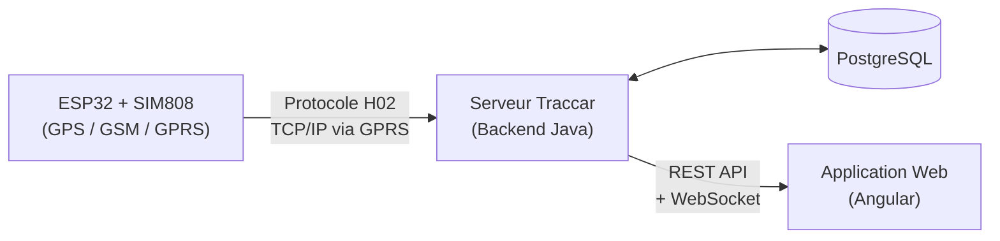

**Flux de données :**

1. Le module ESP32 + SIM808 récupère la position GPS et l'envoie périodiquement au serveur sous forme de trame **H02**.
2. Traccar décode la trame et enregistre la position dans **PostgreSQL**.
3. Le serveur pousse la nouvelle position au navigateur via **WebSocket** ; l'interface met à jour la carte sans rechargement.
4. Les opérations de gestion (utilisateurs, appareils, geofences) passent par l'**API REST**.

<details>
<summary><b>Exemple de trame H02</b></summary>

```
*HQ,865205030330012,V1,145452,A,2240.55181,N,11358.32389,E,0.00,0,100815,FFFFFBFF#
```

| Champ | Signification |
|---|---|
| `*HQ` | En-tête |
| `865205030330012` | IMEI de l'appareil |
| `V1` | Type de trame (données GPS) |
| `145452` | Heure (hhmmss) |
| `A` | Validité des données (A = valides) |
| `2240.55181,N` / `11358.32389,E` | Latitude / Longitude |
| `0.00` | Vitesse (nœuds) |
| `0` | Direction |
| `100815` | Date |
| `FFFFFBFF` | État de l'équipement |

</details>

## 🛠️ Stack technique

| Couche | Technologies |
|---|---|
| **Frontend** | Angular, TypeScript, HTML5, CSS3 |
| **Backend** | Traccar (Java), API REST, WebSocket |
| **Base de données** | PostgreSQL |
| **Embarqué** | ESP32, module SIM808, C++ / Arduino |
| **Protocole** | H02 sur TCP/IP (GPRS) |
| **Outils** | Git / GitLab, Jira (Scrum), StarUML, Postman, WebStorm, IntelliJ IDEA, Arduino IDE |

## ✅ Prérequis

- [Node.js](https://nodejs.org/) (version LTS) et npm
- [Angular CLI](https://angular.dev/tools/cli) : `npm install -g @angular/cli`
- Un serveur **Traccar** fonctionnel (par défaut sur `http://localhost:8082`)

## 🚀 Installation et lancement

**1. Démarrer le backend Traccar** (par défaut sur `http://localhost:8082`).

**2. Cloner le dépôt et installer les dépendances**

```bash
git clone https://github.com/OueledBelkhir-Sahar/trackRp.git
cd trackRp
npm install
```

**3. Lancer le frontend avec le proxy vers Traccar**

```bash
ng serve --proxy-config proxy.conf.json
```

**4. Ouvrir l'application** : [http://localhost:4200](http://localhost:4200)

### ⚙️ Configuration du proxy

Le fichier `proxy.conf.json` redirige les appels API et WebSocket du frontend vers Traccar. Si votre serveur n'est pas sur `localhost:8082`, modifiez-y l'adresse cible.

### 📦 Build de production

```bash
ng build --configuration production
```

Les fichiers générés se trouvent dans le dossier `dist/`.

## 📂 Structure du projet

```
trackRp/
├── docs/screenshots/      # Captures d'écran utilisées dans le README
├── public/                # Ressources statiques (logo, images)
├── src/                   # Code source Angular (composants, services, pages)
├── proxy.conf.json        # Proxy de développement vers le serveur Traccar
├── angular.json           # Configuration Angular CLI
├── package.json           # Dépendances et scripts npm
└── tsconfig*.json         # Configuration TypeScript
```

## 🔌 Matériel embarqué (IoT)

Le traceur est un prototype qui simule le comportement d'un traceur GPS commercial.

| Composant | Rôle |
|---|---|
| **ESP32** + carte d'extension IO | Microcontrôleur : lit les coordonnées et formate les trames H02 |
| **SIM808** | Module GPS / GSM / GPRS tout-en-un |
| **Carte SIM** | Connectivité réseau mobile vers le serveur Traccar |
| **Adaptateur 9V 2A** | Alimentation indépendante et stable du SIM808 |

<div align="center">

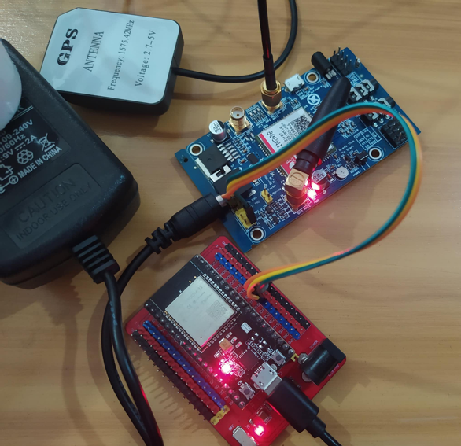

*Montage réalisé : ESP32 (carte rouge), module SIM808 (carte bleue), antenne GPS et alimentation 9V 2A*

</div>

**Câblage (liaison série) :**

| ESP32 | SIM808 |
|---|---|
| GPIO17 (TX) | RX |
| GPIO16 (RX) | TX |
| GND | GND |

> 💡 Grâce au support natif du protocole **H02** par Traccar, d'autres traceurs GPS compatibles peuvent être utilisés à la place du prototype ESP32 + SIM808.

## 🖼️ Captures d'écran

| Connexion | Tableau de bord |
|:---:|:---:|
| 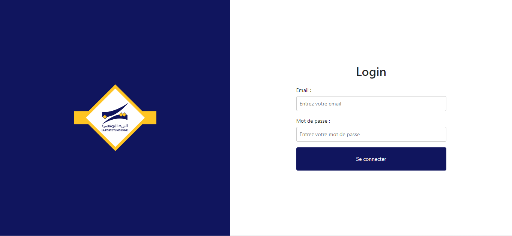 | 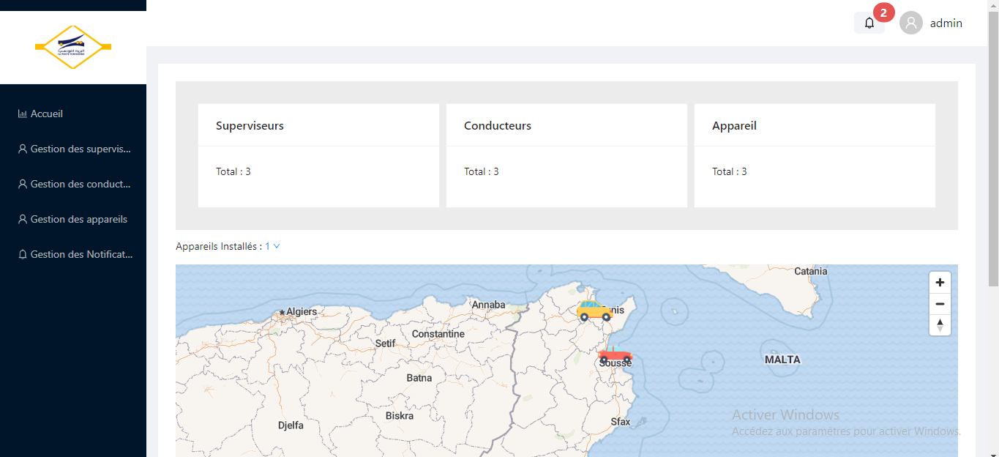 |

| Informations d'un appareil | Zones geofence |
|:---:|:---:|
| 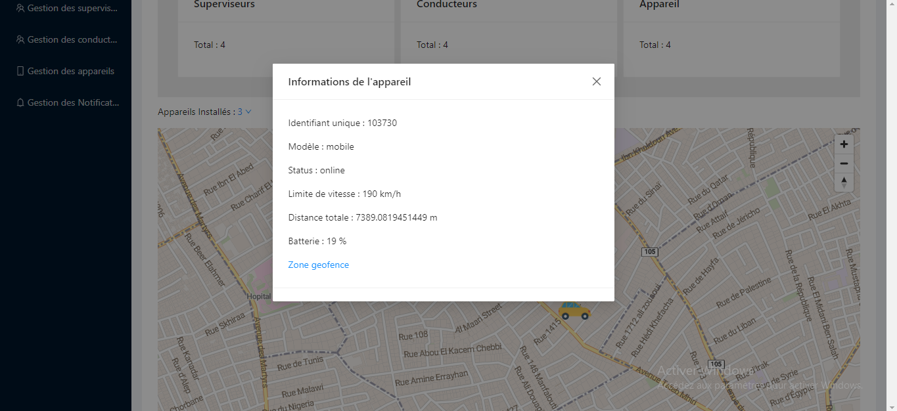 | 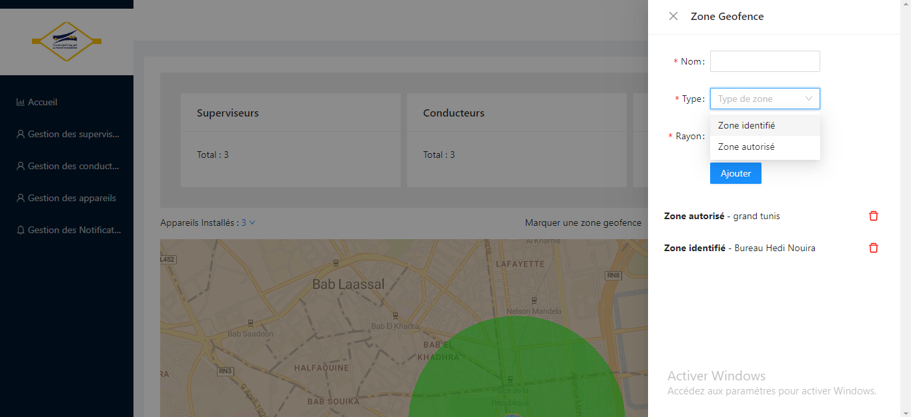 |

| Historique des trajets | Historique des notifications |
|:---:|:---:|
| 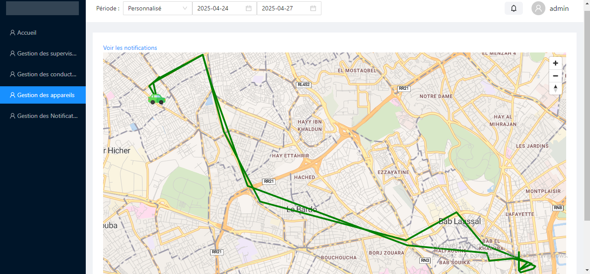 | 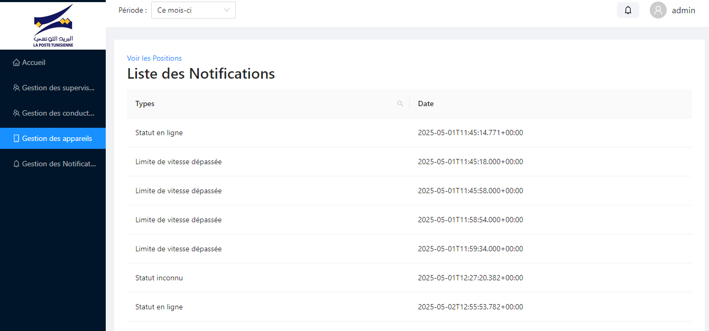 |

| Gestion des appareils | Ajout d'un appareil |
|:---:|:---:|
| 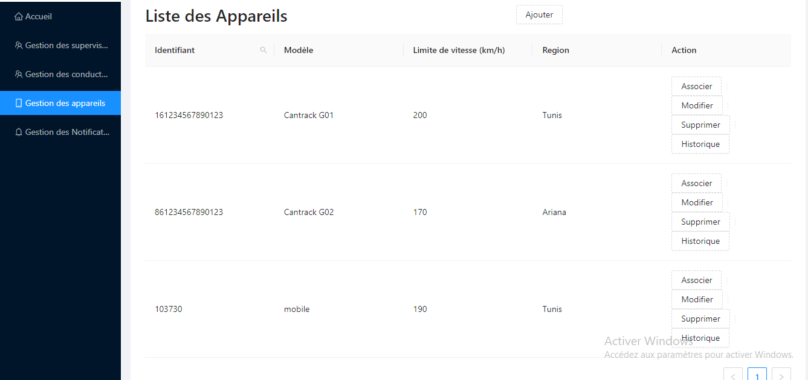 | 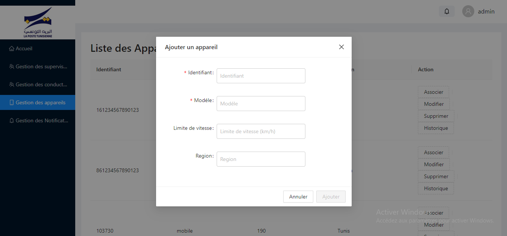 |

| Gestion des superviseurs | Ajout d'un superviseur |
|:---:|:---:|
| 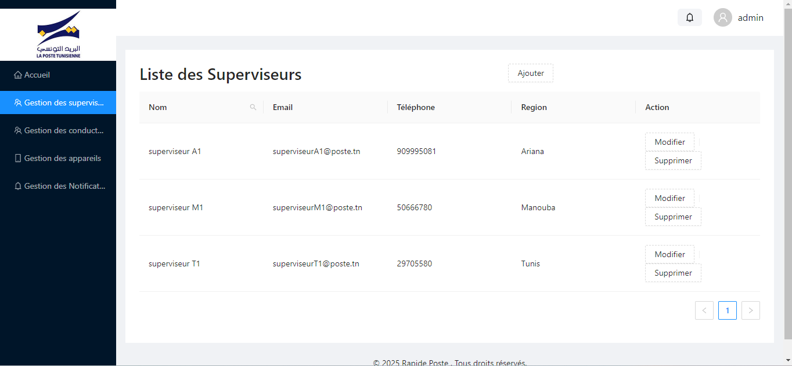 | 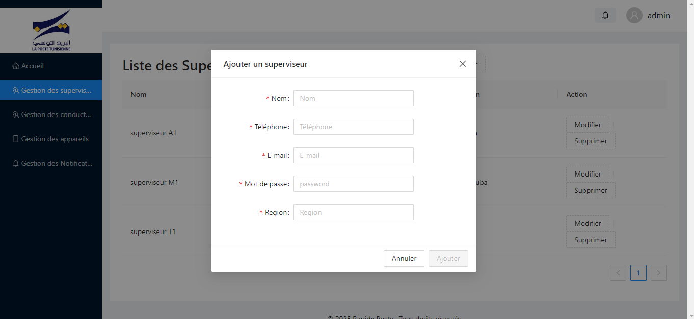 |

| Gestion des conducteurs | Gestion des notifications |
|:---:|:---:|
| 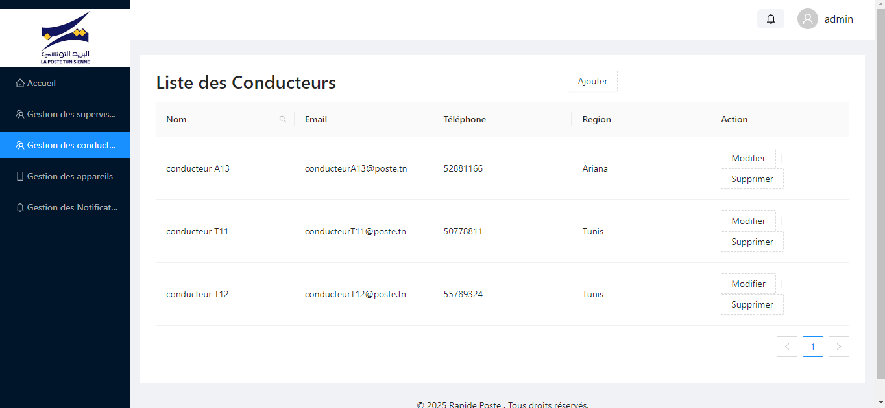 | 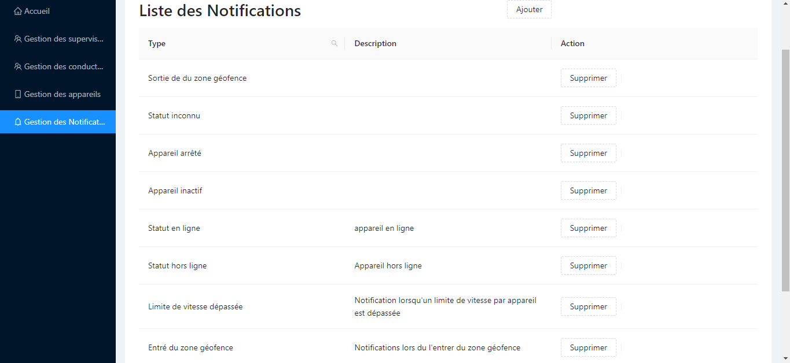 |

## 🔭 Perspectives

- Exploiter la détection d'allumage du moteur et la consommation de carburant avec des **traceurs H02 avancés**.
- Compatibilité avec davantage de modèles de traceurs GPS du marché.
- Génération de **rapports avancés** et alertes automatiques supplémentaires.
- Application mobile dédiée.

## 👩‍💻 Auteure et encadrement

**Réalisé par :** Sahar Oueled Belkhir

| Rôle | Nom |
|---|---|
| Encadrant académique | M. Abdelhalim Najjar |
| Encadrant professionnel | M. Tarek Jarboui |
| Président du jury | Mme Aicha Ben Salem |
| Rapporteur | M. Kheireddine Khemiri |

**Organisme d'accueil :** La Poste Tunisienne (Office National des Postes) – service Rapide Poste
**Établissement :** Institut Supérieur des Sciences Appliquées et de Technologie de Mateur (ISSAT Mateur), Université de Carthage

---

<div align="center">

Projet de fin d'études – Année universitaire 2024/2025

</div>
